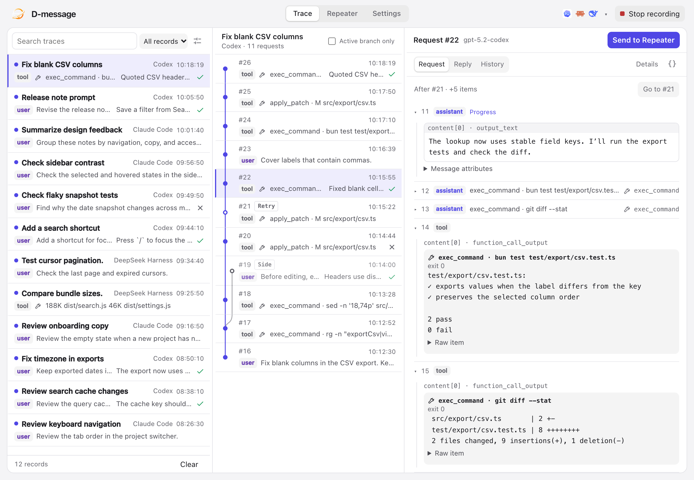
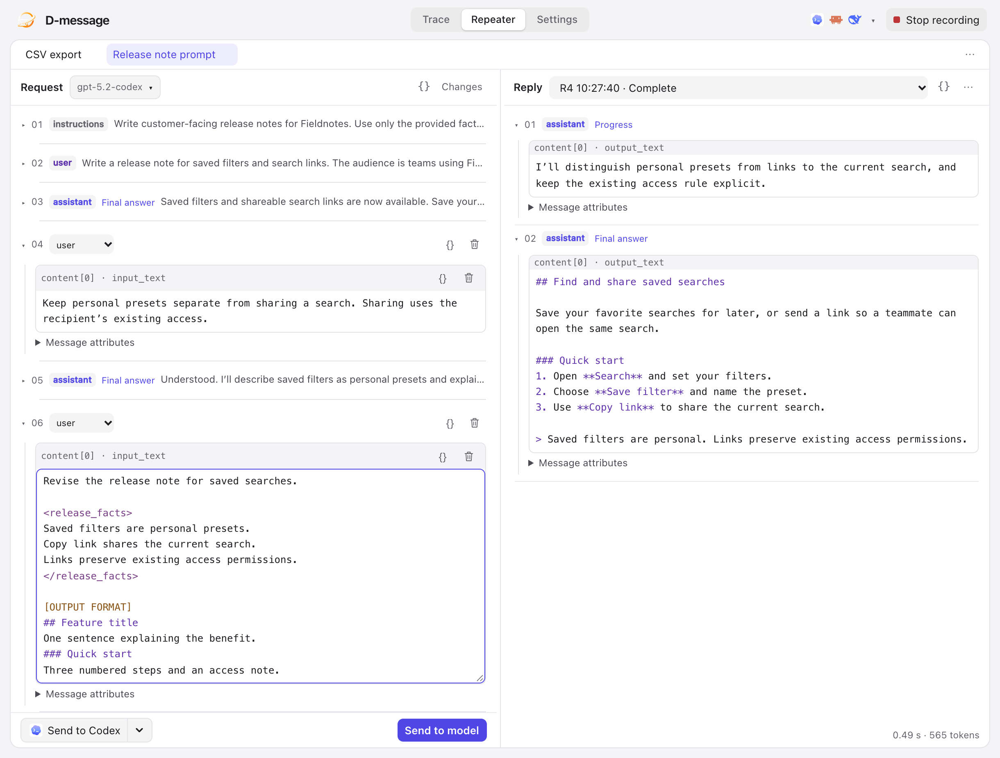

# D-message


[English](README.md) · **简体中文**

追踪并分析经由 Magpie 网关的模型请求与响应轨迹，能任意修改模型轨迹后重放给模型或 agent 会话。

## 安装

安装 Magpie 后，添加已发布的 npm 包：

```sh
magpie plugin add npm:magpie-page-d-message@1.0.0
```

也可从 GitHub 安装同一版本：

```sh
magpie plugin add github:DeePunk42/D-mesage#v1.0.0
```

## 录制和重放一条请求

1. 在 Magpie 侧栏打开 **D-message**，在 **Capture scope** 选择要录制的客户端。
2. 点击 **Start recording**，再用该客户端通过原来的 Magpie 网关发送请求。
3. 在 **Trace** 打开记录查看详情，或点击 **Send to Repeater** 打开可编辑的草稿。
4. 在 **Repeater** 编辑请求，可选用 Magpie 目录中的其他模型，然后点 **Send to model**。在 **Reply** 选择运行即可查看回复，点 **⋯ → View request snapshot** 查看这次实际发送的请求。

## Trace



- **Capture scope** 从 Magpie 的 Agent 模型映射和本机网关用量历史列出客户端。若客户端使用 `magpie-xxx` 作为网关 key，手动添加时填 `xxx`。客户端可用 `X-Magpie-Session` 区分会话。
- **搜索**支持 `request:`、`response:` 和 `tool:`。可组合多个条件，例如 `request:"blue sky" response:ok`。
- **会话**按 session ID 分组。本机有 Codex 或 Claude Code 会话名时优先使用。点开会话可查看分支、重试和压缩。勾选 **Active branch only** 可查看最新捕获请求所在的分支。
- **Request** 显示相对父请求新增的输入，无可比较的父请求时显示完整输入。**History** 显示本次请求携带的上下文，向上滚动加载早期消息。**Reply** 显示录制的回复和工具调用。两个详情页签 **Request** 与 **Reply** 均可通过 **{}** 查看对应的协议 JSON。

## Repeater



- 可原位编辑消息，也可用 **{}** 编辑整份请求 JSON。**Changes** 比较当前草稿和来源请求。草稿保存在本机，每个标签独立保留重放历史。
- **Send to model** 会通过 Magpie 排队执行一次推理，并保存这次实际发送的请求快照。可在模型选单中选择其他模型，使用同一请求测试。重放按网关正常计费。
- **Reply** 显示选中运行的结果。点 **{}** 可查看原始响应，点 **⋯ → Restore draft** 可将该次运行的请求快照载入编辑器。

### 发送到 Agent（macOS）

进入 Repeater 后即可选择三个 Agent，直接发送当前 Request 草稿。跨客户端发送时，目标新建会话，仅接收当前用户消息。可以识别来源 Codex 工作目录时沿用该目录，其他跨端发送使用本机 D-message 的 `replay-workspace`。Claude 原生后台模式需要工作区已获信任且模型认证有效。

| 操作 | 使用的数据 |
| --- | --- |
| **Send to Codex** | 来源为 Codex 的当前草稿。从编辑所属轮次之前分叉，将用户输入加入队列，并打开 Codex App 中的新分支。 |
| **Send to DSH** | 来源为 DeepSeek Harness 的当前草稿。在正在运行的本机 DSH 中找到对应轮次、分叉并发送用户输入。支持修改一条已有的用户文本消息。 |
| **Send to Claude Code** | 编辑 Claude Code 请求草稿中的用户文本，直接发送。Claude 在来源工作目录里创建后台会话，保留该条输入之前的历史。编辑首条输入时新建会话。 |

Claude Code 需要已信任的工作目录，以及后台进程可用的登录或模型配置。Repeater 会显示任务 ID 和等待审批状态，可用 `claude attach <任务 ID>` 接手。此流程只提交用户输入。

自动检测不到 Codex 或 Claude Code 时，可在 **Settings → Replay agents** 设置可执行文件路径。连接 DSH 时，打开 **Settings → Replay agents → DeepSeek Harness**，粘贴本机启动 URL、token 或 Cookie，再点 **Connect**。凭据输入框旁的帮助说明了如何找到启动 URL。用 **Host** 覆盖自动检测的本机地址，用 **Forget credential** 删除已保存的凭据。

## 本地数据与录制范围

- 录制默认关闭。开启后，Trace 会保存所选客户端的请求 JSON 和网关提供的响应，适用于本机连接或使用 Magpie key 的请求。
- 历史和草稿保存在下方数据目录的 `traces.sqlite` 中。连接 DSH 后，凭据也保存在本机。通过 **Trace → Clear → Clear all history** 可删除录制、重放和草稿。
- D-message 可读取本机 Codex 和 Claude Code 的会话数据，用于显示会话名称，以及恢复网关响应中缺失的 Codex 输出。发送到 Codex 或 DSH 时，可读取对应的本机会话日志以定位来源轮次。响应缺失或结果不明确时，会查询 Magpie 的本机请求记录。
- 页面服务和可选的 MCP 监听均绑定本机回环地址。**Send to model** 按捕获的协议通过 Magpie 发送修改后的请求。

| 平台 | 默认数据目录 |
| --- | --- |
| macOS | `~/Library/Application Support/D-message/` |

可设置 `D_MESSAGE_DATA_DIR` 指定其他目录。

## MCP

从 0.0.1 升级后，请在 MCP 客户端刷新工具列表。用 `recording` 控制录制，`trace_find` 和 `trace_read` 检索并查看记录。编辑与重放时，先用 `repeater_open` 打开共享标签，再用 `repeater_tab` 编辑草稿，最后调用 `repeater_send_model`。

MCP 监听默认关闭。在 **Settings → MCP server** 启用监听，选择本机端口，再点击 **Apply**。可用 **Copy client config**，或手动配置界面显示的 Streamable HTTP 地址（默认为 `http://127.0.0.1:34892/mcp`），并添加 `Authorization: Bearer <访问令牌>` 请求头。持有令牌的本机客户端可以读取录制正文、修改共享草稿、发起计费推理，以及向具备原生工具的 Agent 发送请求。

| 工具 | 用途 |
| --- | --- |
| `recording` | 查询录制状态、调整范围、启动或停止录制。开始录制时返回游标，可用于跟踪后续捕获。 |
| `trace_find`、`trace_read`、`session_tree` | 在录制和重放中搜索请求、回复和工具调用。通过 `after_capture` 跟踪新捕获，查看会话分支，或读取消息和协议 JSON。 |
| `repeater_open`、`repeater_tab` | 打开与界面共享的标签，使用 JSON Patch 和当前 `revision` 编辑草稿，查看请求差异、模型运行和 Agent 交付记录。 |
| `repeater_models`、`repeater_send_model`、`repeater_cancel` | 列出 Magpie 的模型，排队发送一次推理，或取消仍在等待的运行。用 `trace_read` 读取返回的 `run_ref`。 |
| `repeater_agent_options`、`repeater_send_agent`、`repeater_dispatch_status` | 查询当前草稿可发送到哪些原生客户端，发给选定的 Agent，再用 `dispatch_ref` 查询交付状态。 |

`repeater_send_agent` 默认使用 `resend_prompt`。传入当前标签的 `tab_ref` 和 `revision`，并将 `target_agent` 设为 `codex`、`dsh` 或 `claude`。这会直接发送草稿中的用户输入，Claude Code 无需先做一次模型重放即可启动后台会话。Claude Code 的兼容模式 `continue_from_reply` 使用该标签下已完成的 `run_ref`。交付回执可包含原生会话 ID、后台任务 ID 或关联的 Trace。任务结果在原生会话中查看。

每次发送使用新的 `request_key`，重试同一次发送时复用原 key。界面与 MCP 共享草稿版本。升级后可在原端点刷新 MCP 客户端的工具列表。

## 开发与许可证

在仓库根目录运行 `bun install --frozen-lockfile` 和 `bun test`。使用 `bun setup.js` 将工作目录注册为本机 Magpie 开发插件。

开发联调直接加载 `dev` 分支的源码，npm 只发布正式版。详见[开发与发布规范](CONTRIBUTING.md)。

[MIT 许可证](LICENSE)
